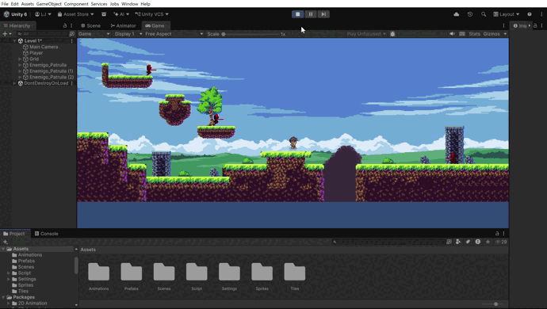
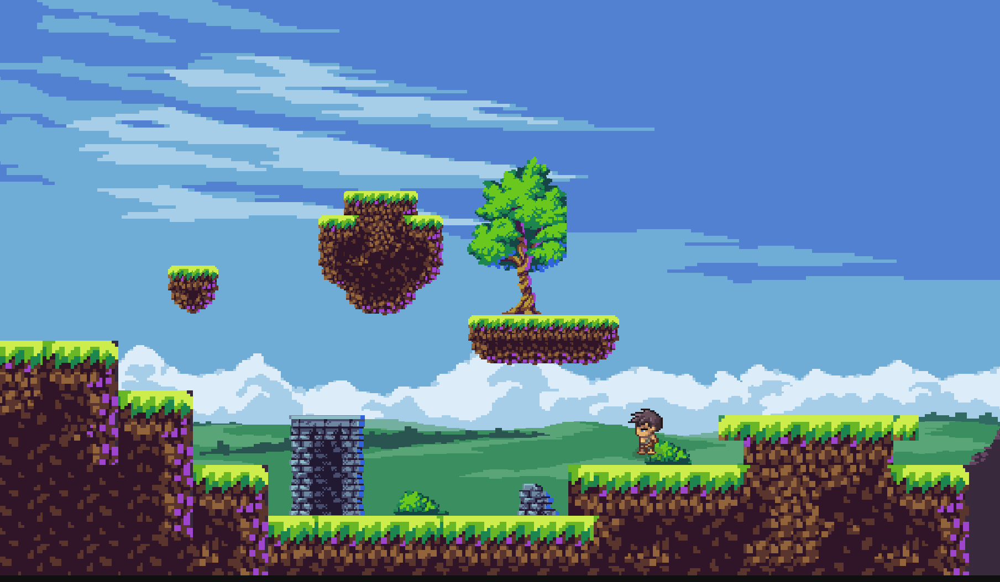
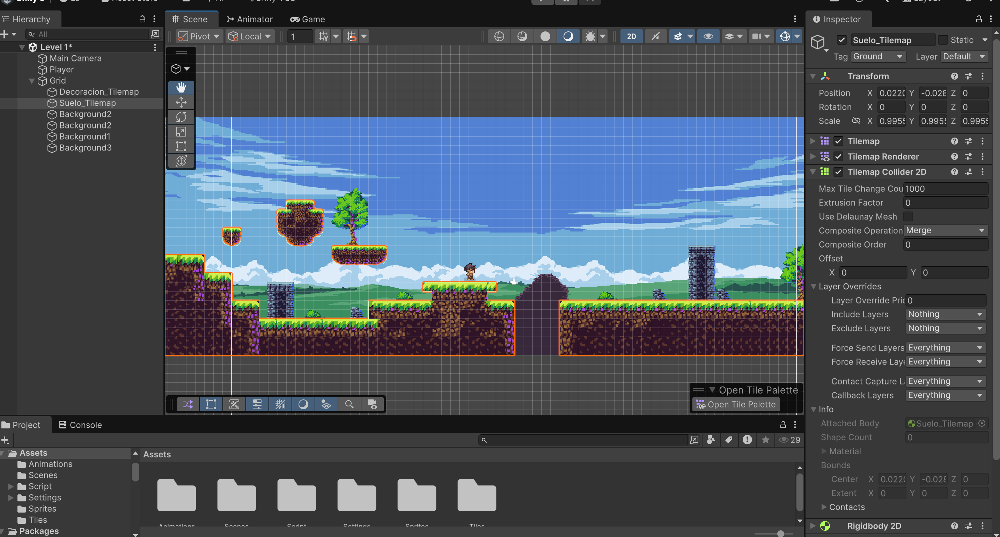

# 🎮 2D Platformer: Movement, Animation, Extended Camera & AI Patrol System

Este repositorio contiene los módulos y scripts de control físico, ciclo de animaciones 2D, seguimiento de cámara sobre niveles extendidos y el sistema de inteligencia artificial autónomo para enemigos patrulleros en Unity.

---

## 📸 Vista General y Demostración en Vivo

### Demostración de Enemigos Patrulleros y Sensores (Taller 5)


### Recorrido y Diseño del Nivel (Gameplay)


### Configuración Técnica de Tilemaps y Colisiones (Inspector)


---

## 📹 Videos Demostrativos

- 🔗 **[Ver Video Demostrativo - Taller 5: Enemigos Patrulleros y Prefabs (Google Drive)](https://drive.google.com/file/d/1vRvUh9a14Pi8t7uVJwAq61Tg9kCLIbPN/view)**
- 🔗 **[Ver Video Demostrativo - Taller 4: Cámara Suave y Nivel Extendido (Google Drive)](https://drive.google.com/file/d/1RtJQNFs8sYJJmL7QVIqkWBqUuMEpf9uO/view)**

---

## 👾 Taller 5: Creación de Enemigo Patrullero Inteligente y Prefabs

En esta fase se implementó un sistema de patrullaje autónomo para enemigos con sensores físicos 2D y modularización mediante Prefabs:

- **Configuración del Enemigo Base (`Enemigo_Patrulla`):**
  - **Componentes Físicos:** `SpriteRenderer`, `BoxCollider2D` y `Rigidbody2D` con restricción activa de rotación (**`Freeze Rotation Z`**) para prevenir giros accidentales por fricción o contacto lateral.
  - **Objeto Hijo Detector (`GroundCheck`):** Sensor posicionado estratégicamente al frente y en la base del enemigo para anticipar vacíos y colisiones frontales.
- **Sensores de Física 2D (`RaycastHit2D`):**
  - **Detección de Vacíos:** Rayo vertical hacia abajo (`Vector2.down`) filtrado por la máscara `LayerMask (Ground)`. Si deja de detectar suelo (`isGroundAhead.collider == null`), activa la inversión de marcha.
  - **Detección de Muros:** Rayo horizontal orientado en la dirección de avance (`Vector2.right` o `Vector2.left`). Al contactar una superficie sólida (`isWallAhead.collider != null`), activa el cambio de dirección.
- **Sistema de Volteo Dinámico (`Flip`):** Inversión de escala horizontal (`transform.localScale.x *= -1`), reorientando de manera automática el detector hijo `GroundCheck` hacia el nuevo frente.
- **Plantilla Reutilizable (Prefab):** Creación del Prefab modular en `Assets/Prefabs`, permitiendo poblar múltiples plataformas del nivel con instancias independientes.

---

## 🚀 Taller 4: Diseño de Niveles Extendidos y Cámara Suave

En esta etapa se diseñó un escenario extendido con desniveles y vacíos para saltos, estructurado en capas visuales y de colisión:

- **Estructura de Tilemaps (`Grid`):**
  - **`Suelo_Tilemap`:** Contiene las superficies transitables configuradas con `Tilemap Collider 2D` y `Composite Collider 2D` en modo **`Merge`** (`Static`), eliminando costuras internas (*ghost collisions*) y con la etiqueta `Ground`.
  - **`Decoracion_Tilemap`:** Diseñado sin colliders para objetos ornamentales y paredes profundas de fondo.
- **Fondo Global Multicapa (`Background`):** Imágenes de fondo organizadas con valores negativos en `Order in Layer` (ej. `-100`) para garantizar su visualización por detrás del jugador y el terreno.
- **Seguimiento de Cámara (`CameraFollow.cs`):**
  - Ejecución en **`LateUpdate()`** para evitar el temblor de pantalla (*jittering*), esperando a que el personaje termine de procesar su movimiento físico.
  - Interpolación suave mediante **`Vector3.Lerp()`** multiplicada por `Time.deltaTime` para un movimiento fluido e independiente del framerate.
  - Configuración de un **Offset** adecuado (`Vector3(0, 2, -10)`) que previene recortes en el plano 2D y mejora la visibilidad del horizonte.

---

## 🏃 Taller 3: Sistema de Control y Animaciones del Personaje

- **Movimiento Horizontal:** Desplazamiento reactivo con físicas mediante `linearVelocity` y lectura del eje horizontal (`Input.GetAxis`).
- **Sistema de Volteo Dinámico (`Flip`):** Inversión del eje $X$ en `transform.localScale` al cambiar de dirección para reutilizar sprites sin duplicar assets.
- **Control de Salto y Detección de Suelo:** Detección de colisión con la etiqueta `Ground` vía `OnCollisionEnter2D` y `OnCollisionExit2D`, previniendo saltos infinitos en el aire.
- **Máquina de Estados en el Animator:** Transiciones sincronizadas de baja latencia (`Has Exit Time` desactivado) entre los estados `Idle`, `Walk` y `Jump`.

### ⚙️ Parámetros del Animator

| Parámetro | Tipo | Uso |
| :--- | :--- | :--- |
| **`Speed`** | `Float` | Controla la transición entre reposo (`Idle`) y movimiento (`Walk`) evaluando `Mathf.Abs(move)`. |
| **`isJumping`** | `Bool` | Activa la animación de salto (`Jump`) y devuelve el control a `Idle` o `Walk` al colisionar con el suelo. |

### 🔄 Lógica de Transiciones

```text
       [ Idle ]  <==== Speed >= 0.1 ====>  [ Walk ]
          ||                                  ||
      isJumping                           isJumping
          ||                                  ||
          \/                                  \/
       ================ [ Jump ] ================